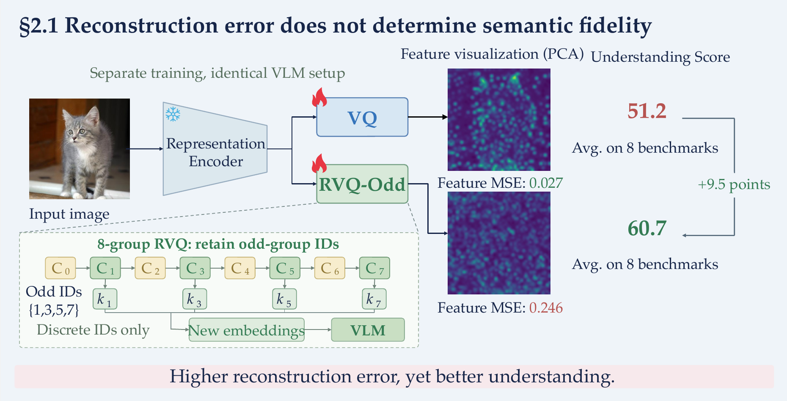
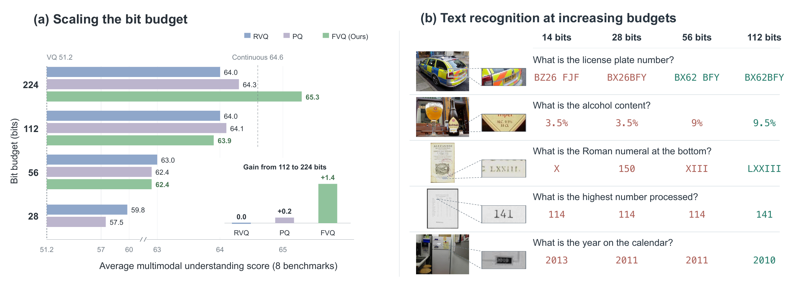
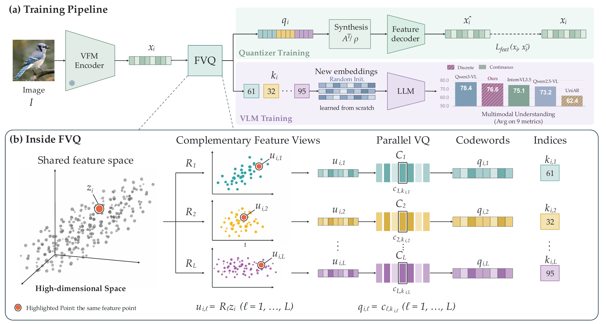

<div align="center">

<h2>Can Discrete Tokens Serve as Semantically Lossless <br> Representations of Visual Signals?</h2>

<p>
<a href="https://github.com/Doctor-James">Jialv Zou</a><sup>1,*,◇</sup>, Xiaotong Li<sup>2,*,†</sup>, Zhengrong Yue<sup>3,◇</sup>, Xu Huang<sup>4,◇</sup>, Yaxin Luo<sup>5,◇</sup>,<br>
Wenhao Yan<sup>6,◇</sup>, Haodong Li<sup>7,◇</sup>, <a href="http://eic.hust.edu.cn/professor/liuwenyu/">Wenyu Liu</a><sup>1</sup>, <a href="https://xwcv.github.io/">Xinggang Wang</a><sup>1,✉</sup>
</p>

<p>
<sup>1</sup> Huazhong University of Science and Technology &nbsp; <sup>2</sup> Meituan LongCat<br>
<sup>3</sup> Shanghai Jiao Tong University &nbsp; <sup>4</sup> Peking University<br>
<sup>5</sup> Mohamed bin Zayed University of Artificial Intelligence<br>
<sup>6</sup> Tsinghua University &nbsp; <sup>7</sup> The Chinese University of Hong Kong
</p>

<p>
<sup>*</sup> Equal contribution &nbsp; <sup>✉</sup> Corresponding author &nbsp; <sup>†</sup> Project lead<br>
<sup>◇</sup> Work done during an internship at Meituan LongCat
</p>

<p>
<a href="https://github.com/hustvl/FVQ"></a>
<a href="https://huggingface.co/hustvl/FVQ"></a>
<a href="LICENSE"></a>
</p>

</div>

## 👀 Introduction

Discrete visual tokens offer a native interface for multimodal modeling under a
shared next-token prediction objective by representing vision in a discrete form
analogous to language. However, quantization error is widely assumed to cause
unavoidable semantic loss, fundamentally limiting the semantic fidelity of discrete
visual tokens and thereby positioning continuous visual representations as an
intrinsic upper bound.

We revisit this assumption using multimodal understanding as a proxy for semantic
fidelity. Our analysis separates reconstruction error from downstream understanding
and identifies the effective bit budget as a key determinant of performance. These
findings motivate **Factorized Vector Quantization (FVQ)**, which alleviates the
high-budget saturation of existing multi-codebook quantizers. Industrial-scale
multimodal training further demonstrates that discrete visual representations can
remain competitive with strong continuous-representation models, including on
fine-grained OCR tasks.

This repository contains a standalone implementation for feature-only tokenizer
training, discrete image encoding, and visual-language training and inference.

## 🔍 Findings

### 1. Quantization error does not determine semantic fidelity

The VLM receives discrete indices rather than reconstructed features and learns
their embeddings from scratch. Reconstruction error therefore does not directly
measure the semantic information available to the VLM.

We compare single-codebook VQ with partial representations from an eight-group RVQ.
RVQ-Odd retains the indices from groups 1, 3, 5, and 7, while RVQ-Even retains groups
0, 2, 4, and 6, using zero-based numbering.

<p align="center">
  <a href="docs/figures/reconstruction_vs_understanding.png">
    
  </a>
</p>

RVQ-Odd has **9.1× higher reconstruction error** than VQ, yet scores **9.5 points
higher** in understanding. RVQ-Even has reconstruction error close to VQ but also
achieves substantially better understanding. Together, these comparisons show that
reconstruction error is not a reliable measure of semantic fidelity.

Figure 2 (left), under the shared Qwen3-1.7B setting; see Table 1 of the paper for
all variants, including RVQ-Even (MSE 0.028, understanding 59.3). MSE is measured on
the ImageNet validation set. Understanding is the eight-benchmark average, with
OCRBench divided by 10.

### 2. Larger bit budgets help when added codes remain informative

Raw visual signals, continuous features, and discrete representations are all
finite-bit encodings in digital systems. For discrete indices, the per-patch bit
budget is **B = L log₂ C**, where L is the number of codebooks and C is the size of
each codebook. The budget grows linearly with L but only logarithmically with C,
making additional codebooks a more efficient scaling strategy.

Increasing the number of codebooks substantially improves RVQ and PQ over
single-codebook methods, but their gains diminish at high budgets. FVQ, by contrast,
continues to improve with larger budgets and ultimately matches the average
understanding performance of continuous QwenViT.



Shared Qwen3-1.7B setting; see Figure 1 and Table 2 of the paper.
Higher budgets progressively recover the fine-grained textual information
required for correct predictions; green and red denote correct and incorrect answers, respectively.

We attribute the high-budget saturation to diminishing information per codebook.
Later RVQ codebooks receive progressively smaller residuals, while PQ divides
features into increasingly narrow channel groups. A larger nominal bit budget
therefore helps only when the additional codes remain semantically informative,
motivating a quantizer that preserves informative inputs as the number of
codebooks grows.

## 📐 Method

FVQ follows three design principles: **symmetric roles across codebooks**,
**fixed-dimensional views derived from the full feature**, and **collective feature
preservation before quantization**.

During quantizer training, multiple dense projections produce complementary views
of the same visual feature, which are quantized in parallel by independent
codebooks. The selected codewords are combined through tight-frame synthesis for
feature reconstruction.



The projected views preserve the feature geometry collectively before
quantization. The analysis–synthesis transform itself introduces no reconstruction
error; all distortion arises from replacing the projected views with their nearest
codewords. Adding codebooks introduces new fixed-dimensional views without
structurally shrinking later residuals or channel groups.

The tokenizer is trained solely to reconstruct frozen VFM features and receives no
pixel-level supervision. In the subsequent VLM training stage, the quantizer is
frozen, and only the resulting discrete indices are mapped to newly initialized
token embeddings for multimodal understanding.

## 📊 Results

### Industrial-scale multimodal understanding

We train on industrial-scale multimodal data and achieve state-of-the-art
performance among discrete-representation models, improving over UniAR and
Emu3-Chat on a nine-metric average by **22.8%** and **59.2%**, respectively.

Selected comparisons from Tables 3 and 4 of the paper:

| Model | MMMU | MMMU-Pro | MathVista | RealWorldQA | MMStar |
| --- | ---: | ---: | ---: | ---: | ---: |
| Qwen3-VL-8B | 69.6 | 55.9 | 77.2 | 71.5 | 70.9 |
| Emu3-Chat-8B | 31.6 | - | 47.6* | 57.4 | 46.5* |
| UniAR-8B | 44.3 | 22.7* | 50.8* | 68.5 | 56.7* |
| **FVQ-8B (Ours)** | **64.3** | **40.8** | **77.4** | **72.0** | **68.5** |

**OCR and document VQA**

| Model | OCRBench | ChartQA | DocVQA | InfoVQA |
| --- | ---: | ---: | ---: | ---: |
| Qwen3-VL-8B | 896 | 89.6 | 96.1 | 83.1 |
| Emu3-Chat-8B | 687 | 68.6 | 76.3 | 42.7* |
| UniAR-8B | 833 | 75.9 | 91.4 | 68.9* |
| **FVQ-8B (Ours)** | **867** | **83.9** | **95.4** | **77.7** |

**Fine-grained recognition and document parsing**

| Model | OCRBenchV2<br>en / zh | CharXiv<br>DQ / RQ | OmniDocBench ↓<br>en / zh |
| --- | ---: | ---: | ---: |
| Qwen3-VL-8B | 65.4&nbsp;/&nbsp;61.2 | 83.0&nbsp;/&nbsp;46.4 | 0.170&nbsp;/&nbsp;0.264 |
| Emu3-Chat-8B | - | 36.8*&nbsp;/&nbsp;14.1* | - |
| UniAR-8B | 43.0*&nbsp;/&nbsp;48.6* | 63.3*&nbsp;/&nbsp;26.8* | 0.482*&nbsp;/&nbsp;0.434* |
| **FVQ-8B (Ours)** | **58.7&nbsp;/&nbsp;59.5** | **86.1&nbsp;/&nbsp;49.3** | **0.179&nbsp;/&nbsp;0.249** |

For a fair comparison, results marked with \* are obtained by us under the same
evaluation setting as our model.
Higher is better except for OmniDocBench.

**Nine-metric average: 76.6.** The nine-metric average is computed over MMMU,
MathVista, MMStar, OCRBench/10, ChartQA, CharXiv-DQ, CharXiv-RQ, DocVQA, and InfoVQA.

## 📦 Models

| Model | Purpose | Download |
| --- | --- | --- |
| FVQ-G16 tokenizer | Encode images as discrete visual IDs | [Hugging Face](https://huggingface.co/hustvl/FVQ/tree/main/FVQ-Tokenizer) |
| FVQ-8B VLM | Multimodal understanding and image-conditioned dialogue | [Hugging Face](https://huggingface.co/hustvl/FVQ/tree/main/FVQ-8B) |

Hugging Face repository: [hustvl/FVQ](https://huggingface.co/hustvl/FVQ).
The tokenizer and VLM exports use the `FVQ-Tokenizer/` and `FVQ-8B/`
subdirectories, respectively.

Our main model pairs Qwen3-8B with an any-resolution visual tokenizer constructed
by applying 16-codebook FVQ to Qwen3 ViT. To preserve a native next-token prediction
setup with minimal modality-specific modifications to the LLM, we use standard
1D RoPE in the LLM and omit the DeepStack connections from Qwen3 ViT.

Weights and training data are not bundled with the source code.

## 🚀 Installation

Requires Python 3.10+. The reference environment uses PyTorch 2.6 and
Transformers 4.57.0. From the repository root:

```bash
pip install -e .
pip install flash-attn --no-build-isolation
```

Use a FlashAttention build compatible with your PyTorch and CUDA versions.
The GPU paths use BF16 and FlashAttention; CPU tokenization uses SDPA.

## 🔧 Quick Start

### Download the models

Download the Hugging Face repository without renaming its subdirectories:

```bash
hf download hustvl/FVQ --local-dir checkpoints/FVQ
```

```text
checkpoints/FVQ/
├── FVQ-Tokenizer/
└── FVQ-8B/
```

`FVQ-8B/` includes its visual tokenizer, visual bridge, LLM, and text tokenizer;
it does not need a separate `FVQ-Tokenizer/` path for inference.

### Ask a question about an image

Use a local image, or generate the synthetic red-square example below:

```bash
python tools/make_demo_data.py --output data/quickstart --records 1
python examples/chat.py \
  --checkpoint checkpoints/FVQ/FVQ-8B \
  --image data/quickstart/images/example.png \
  --prompt "Describe the image." \
  --max-new-tokens 256
```

The model first tokenizes the image into discrete IDs, embeds and merges the
codes, and generates a text response with the LLM.

## 🏋️ Training

Install the training dependencies in the same environment:

```bash
pip install -e '.[training]'
```

Our model follows four sequential stages: tokenizer training, alignment,
pre-training (PT), and supervised fine-tuning (SFT).

| Stage | Trainable components | Launcher | Config |
| --- | --- | --- | --- |
| Tokenizer | FVQ and feature reconstruction modules; frozen vision encoder | [train_tokenizer.sh](scripts/train_tokenizer.sh) | [tokenizer_g16.yaml](configs/tokenizer_g16.yaml) |
| Alignment | Visual embeddings and spatial merger; frozen tokenizer and LLM | [train_alignment.sh](scripts/train_alignment.sh) | [alignment.yaml](configs/alignment.yaml) |
| PT | Visual embeddings, spatial merger, and LLM; frozen tokenizer | [train_pt.sh](scripts/train_pt.sh) | [pt.yaml](configs/pt.yaml) |
| SFT | Visual embeddings, spatial merger, and LLM; frozen tokenizer | [train_sft.sh](scripts/train_sft.sh) | [sft.yaml](configs/sft.yaml) |

The industrial-scale training recipe in Section 4.1 and Table 7 is:

| Setting | Tokenizer | Alignment | PT | SFT |
| --- | --- | --- | --- | --- |
| Training tokens | 100B | 10B | 60B | 30B |
| LLM learning rate | - | Frozen | 1e-5 | 1e-5 |
| Visual learning rate | 1e-4 | 2e-4 | 1e-5 | 2e-6 |
| LR schedule | Cosine | Cosine | Cosine | Constant |
| Weight decay | 0 | 0.05 | 0.05 | 0.05 |
| Warm-up steps | 10K | 1K | 1K | 100 |

All four stages use AdamW with betas `(0.9, 0.96)` and gradient clipping at 1.0.
Pre-training and supervised fine-tuning both keep the tokenizer frozen and jointly
optimize the LLM, visual token embeddings, and merger, using context lengths of 8K
and 16K and maximum image resolutions of 1024px and 2048px, respectively.
Training mixtures cover STEM, OCR, interleaved image-text sequences, image captioning
and text-only data.

The stage YAMLs are configurable runtime examples, not an exact reproduction of
the industrial-scale run. Set their hyperparameters and dataset mixtures for your
training setup; the table above reports the paper's recipe.

### 1. Choose a starting checkpoint

For tokenizer training from scratch, download the Qwen3-VL-8B-Instruct checkpoint
and initialize FVQ from its pretrained vision encoder. The quantizer and feature
decoder are newly initialized; this command does not train them:

```bash
python tools/init_tokenizer.py \
  --vision checkpoints/qwen3-vl-8b \
  --output checkpoints/fvq-init
```

For Alignment, PT, or SFT, set `checkpoint` in the stage YAML to a compatible
FVQ-G16 VLM export containing the visual tokenizer, visual embeddings and merger,
LLM, and text tokenizer. If you already have a standalone FVQ export, no conversion
is needed.

Only existing VLM checkpoints in the supported legacy format need the optional
[conversion step](tools/convert_checkpoint.py) below:

```bash
python tools/convert_checkpoint.py vlm \
  --source checkpoints/legacy-vlm \
  --output checkpoints/FVQ/FVQ-8B
```

### 2. Prepare data

Use your own images and text with the [data templates](examples/data/README.md).
Tokenizer training takes image JSONL; Alignment and PT take JSONL; SFT takes
JSONL or a JSON array of conversations. For example, an SFT JSONL record is:

```json
{"images": ["images/example.png"], "messages": [{"role": "user", "content": "<image>\nDescribe the image."}, {"role": "assistant", "content": "A red square on a white background."}]}
```

Image paths are relative to their data file. Set `data` to that file in the
stage YAML, or use a JSON5 manifest to mix sources:

| Data | Example mixture |
| --- | --- |
| Alignment / caption PT | [pt_data.json5](configs/pt_data.json5) |
| Conversation PT | [pt_conversations_data.json5](configs/pt_conversations_data.json5) |
| SFT | [sft_data.json5](configs/sft_data.json5) |

To try the formats with synthetic data:

```bash
python tools/make_demo_data.py --output data/demo
```

This creates synthetic images and data files for trying the data formats.
See [DATA.md](DATA.md) for sampling, supervision masks, packing, and caching.

### 3. Configure and launch

Set `checkpoint`, `data`, and `output` in the stage YAML; VLM stages also have
a `cache` directory. Choose the GPU count in
[accelerate_ddp.yaml](configs/accelerate_ddp.yaml) for tokenizer training or
[accelerate_zero2.yaml](configs/accelerate_zero2.yaml) for VLM training.

Run the launcher for the stage you need. Complete each stage and select its
saved checkpoint before starting the next:

```bash
bash scripts/train_tokenizer.sh
bash scripts/train_alignment.sh
bash scripts/train_pt.sh
bash scripts/train_sft.sh
```

Paths can also be overridden on the command line. For example, continue PT
with a different mixture as a new run:

```bash
bash scripts/train_pt.sh \
  --checkpoint outputs/pt/step-100000 \
  --data configs/pt_conversations_data.json5 \
  --output outputs/pt_conversations \
  --cache cache/pt_conversations
```

`--checkpoint` starts from model weights with a fresh optimizer and scheduler.
Use `--resume` only to restore the same run with unchanged data, config, and
GPU count.

## 📁 Repository Structure

```text
fvq/
├── src/fvq/          # Visual tokenizer, FVQ, multimodal model, and processing
├── training/         # Tokenizer and VLM trainers, data loading, and caching
├── configs/          # Stage YAMLs, data mixtures, and distributed launch configs
├── scripts/          # Tokenizer, Alignment, PT, and SFT launchers
├── examples/         # Image encoding, dialogue, and synthetic data templates
├── tools/            # Checkpoint initialization/conversion and demo data
├── docs/figures/     # Method and bit-budget scaling figures
└── tests/            # Quantizer, data pipeline, and launcher tests
```

## 🧪 Tests

Install the lightweight data/config dependencies if you did not install the
training extras:

```bash
pip install PyYAML json5
python -m unittest discover -s tests -v
```

## 📄 License and Acknowledgements

FVQ code and the tokenizer and VLM weights use the
[Apache License 2.0](LICENSE).
Third-party components retain their own licenses; see
[THIRD_PARTY_NOTICES.md](THIRD_PARTY_NOTICES.md). Model weights and tokenizer
assets have separate license requirements from the Transformers implementation.
